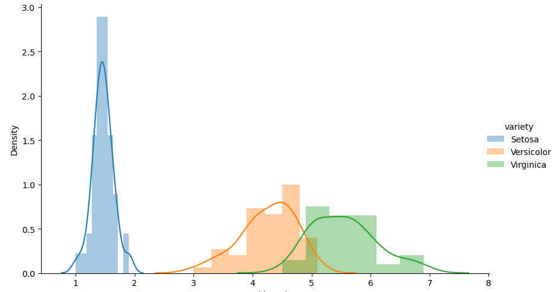
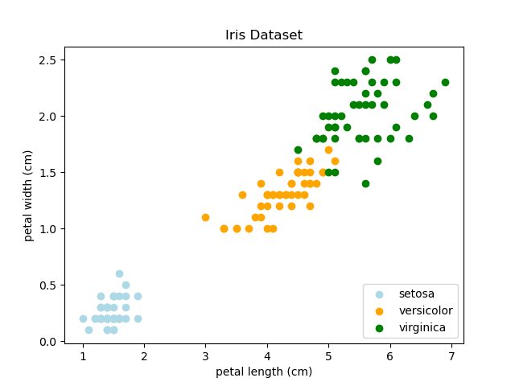

#+TITLE: AICE3001/AICE6002: Mathematics of Machine Learning
#+SUBTITLE: Subsidiary Notes --- Lecture 28: When Machine Learning Works
#+SETUPFILE: setup.org

* Keywords
  * When ML Works, Bias Variance, Shrinkage, Ridge Regression, Ensembles

* Main Points

** Generalisation
   - We train our learning machines on a finite data set
   - But we use our learning machines on unseen data
   - If we have a too simple machine we might not be able to fit the
     training data and are unlikely to do well on unseen data
     #+ATTR_LATEX: :width 0.4\textwidth
     [[file:figures/curveFitting-1.pdf]]
   - If we have a too complicated machine we might be able to fit the
     training data almost perfectly, but we might have learnt a too
     complex rule that doesn't fit the test set
     #+ATTR_LATEX: :width 0.4\textwidth
     [[file:figures/curveFitting-3.pdf]]
   - Often there is a good compromise so that the learning machine
     learns a simple rule that fits the training data quite well but
     isn't too complicated
     #+ATTR_LATEX: :width 0.4\textwidth
     [[file:figures/curveFitting-2.pdf]]
   - We can think of the features and labels coming from an underlying
     distribution $\mu(\bm{x},y)$.  For example, in the famous iris
     dataset we have four features (petal/sepal length/width).  We
     imagine there is some probability density function for each
     feature.  The petal length might be distributed as shown
     #+ATTR_LATEX: :width 0.4\textwidth
     
   - The features are actually jointly distributed (in 4
     "dimensions").  E.g. the petal length and petal width are quite correlated
     #+ATTR_LATEX: :width 0.4\textwidth
     
   - An assumption we make (which has to be approximately correct for
     machine learning to have a chance of working) is that the
     testing data (where we are going to use the machine) is similar
     to the training data.  Mathematically we can model this by
     assuming they both come from the same underlying distribution,
     $\mu(\bm{x}, y)$

** Bias-Variance Dilemma
    - We draw training sets $\mathcal{D}$ of $m$ independent examples
      from $\mu(\bm{x},y)$ and train a machine
      $\hat{f}(\bm{x}\vert\bm{\theta}_\mathcal{D})$ on each
    - Its generalisation loss is
      $$ L_G(\bm{\theta}_\mathcal{D}) = \sum_{(\bm{x},y)} \mu(\bm{x},y)
         \left(\hat{f}(\bm{x}\vert\bm{\theta}_\mathcal{D}) - y\right)^2 $$
      For any particular data set we might do better or worse than the
      expected generalisation loss
      $\bar{L}_G = \av[\mathcal{D}]{L_G(\bm{\theta}_\mathcal{D})}$
    - The /mean machine/ averages the predictions of machines trained on
      all possible data sets (a thought experiment, not something
      practical)
      $$ \hat{f}_m(\bm{x}) = \av[\mathcal{D}]{\hat{f}(\bm{x}\vert\bm{\theta}_\mathcal{D})} $$
    - Adding and subtracting $\hat{f}_m(\bm{x})$,
      \begin{align*}
        \bar{L}_G &= \sum_{(\bm{x},y)} \mu(\bm{x},y)\,
          \av[\mathcal{D}]{\left(\bigl(\hat{f}(\bm{x}\vert\bm{\theta}_\mathcal{D})
          - \hat{f}_m(\bm{x})\bigr) + \bigl(\hat{f}_m(\bm{x}) - y\bigr)\right)^2} \\
        &= \sum_{(\bm{x},y)} \mu(\bm{x},y)\,\av[\mathcal{D}]{\bigl(
          \hat{f}(\bm{x}\vert\bm{\theta}_\mathcal{D}) - \hat{f}_m(\bm{x})\bigr)^2}
          + \sum_{(\bm{x},y)} \mu(\bm{x},y)\bigl(\hat{f}_m(\bm{x}) - y\bigr)^2
        = V + B
      \end{align*}
      + The cross term vanishes because
        $\av[\mathcal{D}]{\hat{f}(\bm{x}\vert\bm{\theta}_\mathcal{D}) -
        \hat{f}_m(\bm{x})} = 0$, while $\hat{f}_m(\bm{x}) - y$ does not
        depend on the data set
      + We used $\av{A+B} = \av{A}+\av{B}$ and $\av{c\,A} = c\,\av{A}$
        for $c$ not depending on the random variable
    - The *bias* $B$ is the generalisation loss of the mean machine; the
      *variance* $V$ measures how much a single machine varies with the
      data set
    - *Where is the noise?*  If $y = f^*(\bm{x}) + \epsilon$ with
      $\av{\epsilon}=0$ and $\mathrm{Var}(\epsilon) = \sigma^2$, the same
      trick (the cross term again vanishes) gives
      $$ B = \sigma^2 + \sum_{\bm{x}}\mu(\bm{x})\bigl(\hat{f}_m(\bm{x}) - f^*(\bm{x})\bigr)^2 $$
      so $\bar{L}_G = \text{noise} + \text{bias}^2 + \text{variance}$, the
      form often seen elsewhere.  The noise is the same for every
      machine; here we keep it inside $B$
    - The *Bias-Variance Dilemma* is that
      + simple machines are likely to have high bias: they cannot
        represent the data well, so neither can their mean
      + complex machines are likely to have high variance: they are
        sensitive to the particular training set
      + this is a tendency, not a law: the average of many decision
        trees can represent a far more complex boundary than a single
        tree

** Shrinkage
   - Estimate the mean $\theta$ of a distribution with variance
     $\sigma^2$ from $m$ samples.  The sample mean $\bar{x}$ is unbiased
     with variance $\sigma^2/m$
   - The deliberately biased estimate $\hat{\theta} = c\,\bar{x}$,
     $0\leq c\leq1$, has $\av{\hat{\theta}} = c\,\theta$ and
     $\mathrm{Var}(\hat{\theta}) = c^2\sigma^2/m$, so
     $$ \av{\bigl(\hat{\theta} - \theta\bigr)^2} = (1-c)^2\,\theta^2 + c^2\,\frac{\sigma^2}{m} $$
   - Its derivative with respect to $c$ at $c=1$ is $2\sigma^2/m > 0$, so
     shrinking a little always reduces the error: a biased estimate
     beats the unbiased one.  The best $c$ depends on the unknown
     $\theta$, so in practice it is chosen by validation

** Ridge Regression Through the SVD
   - Data $\bm{y} = \mat{X}\bm{w}^* + \bm{\epsilon}$ with independent
     noise of variance $\sigma^2$ on each target.  Ridge regression
     minimises $\|\mat{X}\bm{w}-\bm{y}\|^2 + \eta\|\bm{w}\|^2$, giving
     $\hat{\bm{w}} = (\mat{X}^\tr\mat{X} + \eta\mat{I})^{-1}\mat{X}^\tr\bm{y}$
   - With the SVD $\mat{X} = \mat{U}\mat{S}\mat{V}^\tr$ (columns
     $\bm{u}_k$, $\bm{v}_k$, singular values $s_k$),
     $\mat{X}^\tr\mat{X} + \eta\mat{I} = \mat{V}(\mat{S}^2 + \eta\mat{I})\mat{V}^\tr$,
     so in the basis of the $\bm{v}_k$ each component separates.  Writing
     $w^*_k = \bm{v}_k^\tr\bm{w}^*$ for the component of $\bm{w}^*$ along
     $\bm{v}_k$ (not its $k$-th coordinate), and using
     $\bm{u}_k^\tr\mat{X}\bm{w}^* = \sum_j s_j(\bm{u}_k^\tr\bm{u}_j)(\bm{v}_j^\tr\bm{w}^*) = s_k w^*_k$:
     $$ \hat{w}_k = \frac{s_k\,\bm{u}_k^\tr\bm{y}}{s_k^2+\eta}, \qquad
        \bm{u}_k^\tr\bm{y} = s_k\,w^*_k + \bm{u}_k^\tr\bm{\epsilon} $$
     and $\bm{u}_k^\tr\bm{\epsilon}$ has mean 0 and variance $\sigma^2$
   - Hence
     $$ \av{\hat{w}_k} = \frac{s_k^2}{s_k^2+\eta}\,w^*_k, \qquad
        \mathrm{Var}(\hat{w}_k) = \frac{\sigma^2 s_k^2}{(s_k^2+\eta)^2} $$
     and
     $$ \av{\|\hat{\bm{w}} - \bm{w}^*\|^2} = \sum_k
        \Bigl(\frac{\eta}{s_k^2+\eta}\Bigr)^2 {w^*_k}^2 +
        \frac{\sigma^2 s_k^2}{(s_k^2+\eta)^2} $$
     For test inputs with identity covariance this is the expected test
     error minus the noise
   - With $\eta = 0$ (least squares) the bias is zero but the variance is
     $\sum_k\sigma^2/s_k^2$: small singular values, i.e. an
     ill-conditioned $\mat{X}$, make it huge.  A small $\eta$ shrinks
     exactly those directions.  In the lecture's example (ten singular
     values from 3 to 0.1, $\sigma=1$) least squares has error 188 and
     the best $\eta\approx1$ gives 6.5
     #+ATTR_LATEX: :width 0.6\textwidth
     [[file:figures/ridgeBV-0.pdf]]

** Ensembles
   - An ensemble averages $M$ predictors trained with different
     randomness, $\bar{f}_M(\bm{x}) = \frac1M\sum_{i=1}^M f_i(\bm{x})$.
     The mean, and so the bias, is unchanged
   - If each $f_i(\bm{x})$ has variance $s^2$ and each pair has
     correlation $\rho$, then
     $$ \mathrm{Var}\bigl(\bar{f}_M(\bm{x})\bigr) = \frac{1}{M^2}\Bigl(M s^2 + M(M-1)\rho\,s^2\Bigr)
        = \rho\,s^2 + \frac{1-\rho}{M}\,s^2 $$
     More members remove the second term, but correlation leaves a floor
     $\rho\,s^2$
   - /Bagging/ trains each member on a bootstrap resample of the data;
     /random forests/ also choose each split of each tree from a random
     subset of the features, making each tree worse but the trees less
     correlated; /deep ensembles/ train several networks from different
     random initialisations
   - The spread of the members' predictions is a useful measure of
     uncertainty

* Exercises

** Limits of ridge regression
   - Using the formula for $\av{\|\hat{\bm{w}} - \bm{w}^*\|^2}$, what
     happens to the bias and the variance as $\eta\to0$ and as
     $\eta\to\infty$?

** How big an ensemble?
   - Members of an ensemble have pairwise correlation $\rho = 0.2$.  How
     many members are needed for the variance of the average to be
     within 10% of its floor $\rho\,s^2$?

** Where is the noise?
   - Derive $B = \sigma^2 + \sum_{\bm{x}}\mu(\bm{x})\bigl(\hat{f}_m(\bm{x}) -
     f^*(\bm{x})\bigr)^2$ when $y = f^*(\bm{x}) + \epsilon$.

* Experiments

** Bias and variance of ridge regression
   - Train ridge regression on many independent training sets, estimate
     the mean machine and the variance, and compare with the formulas
#+BEGIN_SRC python
import numpy as np

rng = np.random.default_rng(0)
m, p, sigma = 30, 10, 1.0
s = np.geomspace(3, 0.1, p)                        # singular values
U, _ = np.linalg.qr(rng.standard_normal((m, p)))
V, _ = np.linalg.qr(rng.standard_normal((p, p)))
X = U @ np.diag(s) @ V.T
w_star = V @ np.ones(p)

for eta in [0.0, 0.1, 1.0, 10.0]:
    W = []
    for _ in range(5000):                          # many training sets
        y = X @ w_star + sigma * rng.standard_normal(m)
        W.append(np.linalg.solve(X.T @ X + eta * np.eye(p), X.T @ y))
    W = np.array(W)
    w_mean = W.mean(0)                             # the "mean machine"
    bias2 = ((w_mean - w_star) ** 2).sum()
    var = ((W - w_mean) ** 2).sum(1).mean()
    f = s**2 / (s**2 + eta)                        # theory, SVD basis
    print(f"eta {eta:5}: bias2 {bias2:7.3f} ({((1 - f)**2).sum():7.3f})"
          f"  variance {var:7.2f} ({(sigma**2 * f**2 / s**2).sum():7.2f})")
#+END_SRC
   - The numbers in brackets are the formulas.  (See the answers.)

* Answers

** Limits of ridge regression
   - As $\eta\to0$ the bias goes to 0 and the variance to
     $\sum_k\sigma^2/s_k^2$ (least squares).  As $\eta\to\infty$ every
     component is shrunk to 0: the variance goes to 0 and the bias to
     $\sum_k {w^*_k}^2 = \|\bm{w}^*\|^2$

** How big an ensemble?
   - We need $(1-\rho)s^2/M \leq 0.1\,\rho\,s^2$, i.e.
     $M \geq (1-\rho)/(0.1\,\rho) = 0.8/0.02 = 40$

** Where is the noise?
   - With $y = f^*(\bm{x}) + \epsilon$,
     $\bigl(\hat{f}_m(\bm{x}) - y\bigr)^2 = \bigl(\hat{f}_m(\bm{x}) -
     f^*(\bm{x})\bigr)^2 - 2\bigl(\hat{f}_m(\bm{x}) - f^*(\bm{x})\bigr)\epsilon + \epsilon^2$.
     Averaging over $\epsilon$ at fixed $\bm{x}$, the middle term vanishes
     because $\av{\epsilon} = 0$ and the last gives $\sigma^2$

** Bias and variance of ridge regression
   - The simulation gives
     | $\eta$ | bias$^2$ (formula) | variance (formula) |
     |--------+--------------------+--------------------|
     |      0 | 0.021 (0)          | 190.6 (188.5)      |
     |    0.1 | 2.44 (2.39)        | 12.32 (12.30)      |
     |      1 | 5.31 (5.28)        | 1.22 (1.22)        |
     |     10 | 8.15 (8.15)        | 0.08 (0.08)        |
   - The simulation agrees with the formulas; the small "bias" at
     $\eta = 0$ is sampling noise in the estimate of the mean machine
     (about $190/5000\approx0.04$)

* COMMENT [[file:wasserstein.org][Previous]]  [[file:overfitting.org][Next]]
